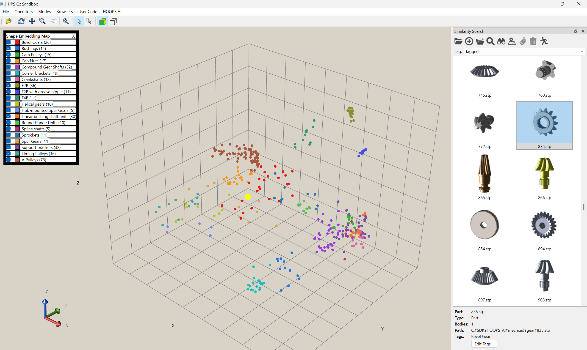
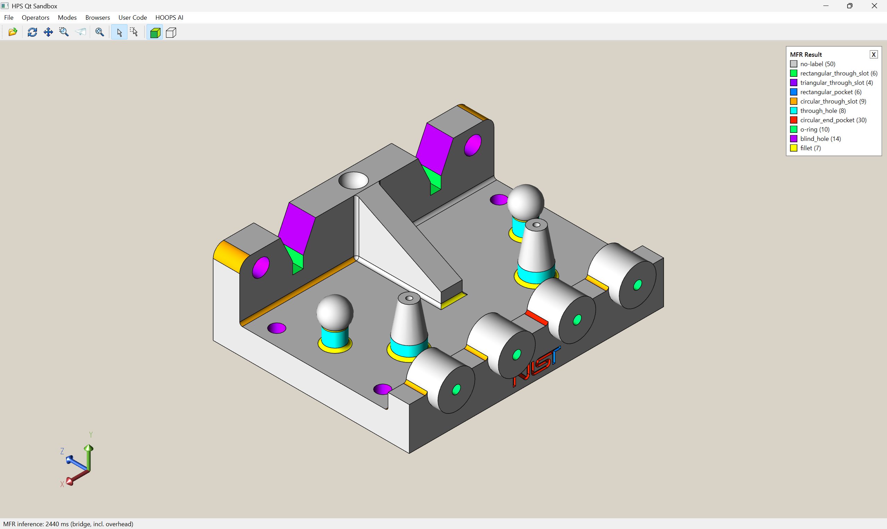
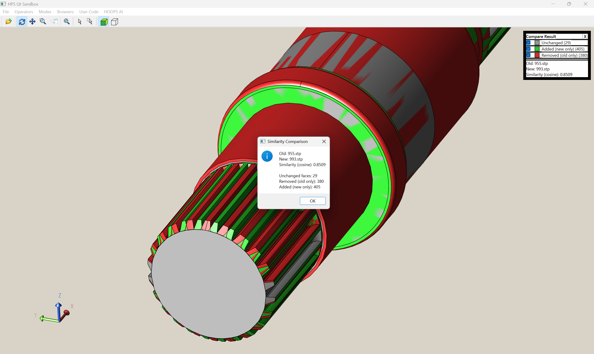
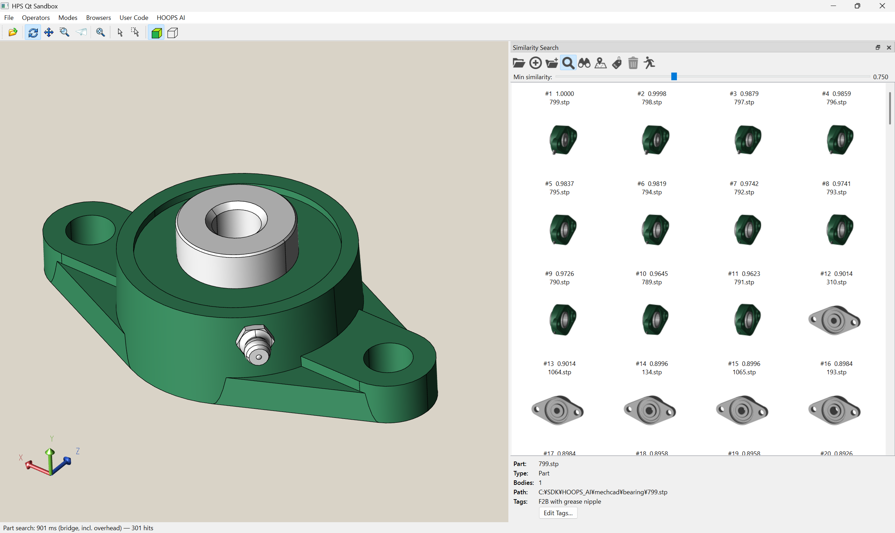
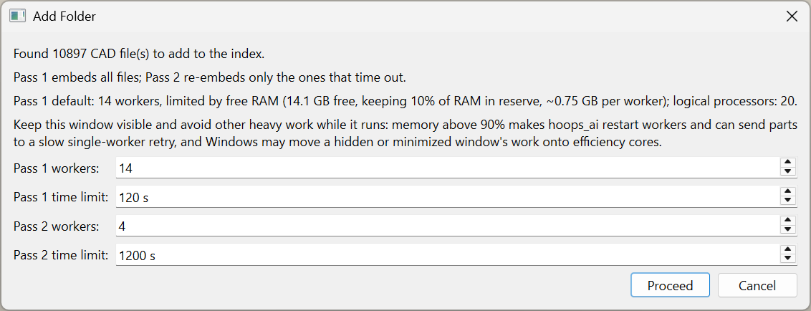

<!-- This file is the Japanese translation of README.md. When you change either README, update the other so both languages stay in sync. -->

# hoops_ai_qt_sandbox

**言語 / Languages:** [English](README.md) | 日本語

**HOOPS Visualize Desktop**、**HOOPS Exchange**、**HOOPS AI Native Bridge** を組み合わせ、AI 支援の CAD ワークフローを示す Qt サンプルアプリケーションです：

- **MFR (Manufacturing Feature Recognition)** — 読み込んだモデルのすべての面を分類し、認識された製造フィーチャーごとに色分けして凡例を表示します。
- **Shape similarity comparison** — shape-embeddings モデルを使って、読み込んだ 2 つの部品間のコサイン類似度を計算します。
- **Similarity Search panel** — FAISS インデックスを構築／オープンし、CAD ファイルやフォルダー全体を追加し、類似部品を検索し、アセンブリ間の類似部品検索を実行し、部品にタグを付け、インデックス全体をクラスタ化した **Shape Embedding Map** として 3D ビューに可視化します。

HOOPS Visualize Desktop に同梱されている `qt_sandbox` サンプルから派生し、HOOPS AI 統合を加えて拡張したものです。呼び出している C API は、HOOPS AI パッケージを実行する Python インタープリタを埋め込んだコンパニオンリポジトリ
[`hoops_ai_native_bridge`](https://github.com/toshi-bata/hoops_ai_native_bridge) にあります。

このサンプルの背景と結果については、
[HOOPS AI Inside a HOOPS Visualize Desktop + Exchange Application: Similar-Part Search Across 10,000 CAD Files](https://forum.techsoft3d.com/t/hoops-ai-inside-a-hoops-visualize-desktop-exchange-application-similar-part-search-across-10-000-cad-files/5203)
を参照してください。ブリッジ自体については
[Using HOOPS AI from a Fully Local Desktop Application](https://forum.techsoft3d.com/t/using-hoops-ai-from-a-fully-local-desktop-application/5200)
で紹介されています。

> **This is a proof of concept, not a product.** これは、HOOPS AI をネイティブの HOOPS Visualize Desktop +
> Exchange アプリケーションの中で動作させられることを示すためのものであり、そのまま出荷することを意図した
> ものではありません。ここで使用している学習済みモデル（MFR と類似部品検索）は HOOPS AI チュートリアルに付属する
> サンプルの `.ckpt` ファイルです。製品システムであれば、独自の部品とラベル体系に対してモデルを学習させるべきです。
> このリポジトリは、製品品質のコードというより出発点として扱ってください。

<p align="center">
  <br>
  <em>Shape Embedding Map — インデックス全体をクラスタ化した 3D マップに投影し、タグごとに色分けして、
  右側に一致部品のギャラリーを表示したものです。</em>
</p>

## 前提条件

| コンポーネント | バージョン |
| --- | --- |
| HOOPS Visualize Desktop | 2026.2.0 |
| HOOPS Exchange | 2026.2.0（HOOPS AI が使用するバージョンと一致している必要があります — 下記の補足を参照） |
| HOOPS AI | V1.1 (tested with 1.1.1) |
| `hoops_ai_native_bridge` | 対応するビルド |
| Qt | 6.5.3（Windows では msvc2019_64、Linux では gcc_64、またはディストリビューションの Qt6 パッケージ） |
| Python | 3.12 |
| Visual Studio（Windows） | 2022 |
| CMake（Linux、`hoops_ai_native_bridge` のビルド用） | 3.20+ |

有効な HOOPS ライセンスが必要です。単一の統合キーで 3 つの製品 — HOOPS AI、HOOPS Visualize Desktop、HOOPS
Exchange — すべてをカバーするため、使用するキーで 3 つすべてが有効になっていることを確認してください（HOOPS AI は
評価用に利用できます）。ライセンスは `hoops_license.h` から読み込まれますが、このファイルはこのリポジトリでは
追跡され**ません**（`.gitignore` を参照）。自分の `HOOPS_LICENSE` 文字列を使ってローカルで作成してください。

## セットアップ

### Windows

1. 環境テンプレートをコピーして、自分用の `_VS2022.bat` を作成します：

   ```powershell
   Copy-Item _VS2022.bat.example _VS2022.bat
   ```

2. `_VS2022.bat` 内のパスを自分の環境に合わせて編集します：

   - `HVISUALIZE_INSTALL_DIR` — HOOPS Visualize Desktop のインストールディレクトリ
   - `HEXCHANGE_INSTALL_DIR` — HOOPS Exchange のインストールディレクトリ
   - `HAI_BRIDGE_INSTALL_DIR` — `hoops_ai_native_bridge` のインストールディレクトリ
   - `QT_INSTALL_DIR` — Qt 6.5.3（msvc2019_64）のインストールディレクトリ
   - `HOOPS_AI_HOME` — *（任意、開発時のみ）* site-packages を
     `<home>\.venv\Lib\site-packages` に解決します。設定されていない場合、クライアントは再配布レイアウト
     `<exe>\..\.venv\Lib\site-packages` にフォールバックします。クライアントは site-packages を解決し、
     UTF-8 としてブリッジに渡します。
   - `HOOPS_AI_PYTHON_HOME` — *（任意）* Python 3.12 のインストールディレクトリ。通常は不要です。ブリッジは
     Windows レジストリ（PEP 514）から Python を自動検出します。自動検出が失敗する特殊な構成の場合にのみ
     設定してください。
   - `devenv.exe` のパス — お使いの Visual Studio 2022 エディションに合わせて調整します。

   `_VS2022.bat` にはマシン固有のパスが含まれており、`.gitignore` によってバージョン管理から除外されています。
   各マシンで作り直してください。

3. `_VS2022.bat` を実行します。環境変数が設定された状態で Visual Studio 2022 を起動し、
   `hps_qt_sandbox.sln` を開きます。

4. **Debug** または **Release** 構成を選択してビルド／実行します。

### Linux

このプロジェクトは qmake/make でビルドし、IDE のステップはありません。すべての SDK／ツールチェーンの場所は
環境変数から取得され（`hps_qt_sandbox.pro` がパスをハードコードすることはありません）、同じ手順がどのマシンでも
機能します。

1. ツールチェーンとヘッダーをインストールします（Ubuntu/Debian のパッケージ名）：

   ```bash
   sudo apt-get install -y build-essential qt6-base-dev qt6-base-dev-tools \
       libgl1-mesa-dev libx11-dev libxmu-dev libxcb-cursor0 cmake
   ```

   厳密な Qt バージョンが不要であれば、システムの Qt6（`qt6-base-dev`）で十分です。そうでなければ Qt 6.5.3 を
   インストールし（例：Qt オンラインインストーラー経由）、ステップ 2 で `QT_INSTALL_DIR` をそこに向けてください。

2. 環境テンプレートをコピーしてパスを編集します：

   ```bash
   cp _linux_env.sh.example _linux_env.sh
   # edit HVISUALIZE_INSTALL_DIR, HEXCHANGE_INSTALL_DIR, HAI_BRIDGE_INSTALL_DIR,
   # QT_INSTALL_DIR, HOOPS_AI_HOME in _linux_env.sh
   source _linux_env.sh
   ```

   `_linux_env.sh` にはマシン固有のパスが含まれており、（Windows の `_VS2022.bat` と同様に）`.gitignore` に
   よってバージョン管理から除外されています — 各マシンで作り直してください。

3. このマシン用に `hoops_ai_native_bridge` 共有ライブラリをビルドします（別の glibc/Python ビルドでビルド済みの
   `.so` は読み込めません — 下記の補足を参照）：

   ```bash
   cd "$HAI_BRIDGE_INSTALL_DIR"
   cmake -S . -B build && cmake --build build
   ```

4. サンドボックス本体をビルドします。これは `$HAI_BRIDGE_INSTALL_DIR` ではなく、**repository root**
   （`hps_qt_sandbox.pro` がある場所）に戻って実行してください — ステップ 3 のブリッジディレクトリにまだいる
   場合は、先にそこへ `cd` で戻ってください：

   ```bash
   cd /path/to/hoops_ai_qt_sandbox   # the repo root; cd back here if still in $HAI_BRIDGE_INSTALL_DIR
   mkdir -p build_linux && cd build_linux
   qmake ../hps_qt_sandbox.pro -o Makefile
   nice -n 10 make -j2   # low -j keeps memory usage down on constrained VMs; raise if you have RAM to spare
   ```

   実行ファイルは `$HVISUALIZE_INSTALL_DIR/bin/linux64/hps_qt_sandbox` に生成されます（その rpath はすでに
   Qt、Visualize、Exchange、ブリッジの lib ディレクトリをカバーしています）。

5. 実行します（`_linux_env.sh` の同じ `HVISUALIZE_INSTALL_DIR`/`HEXCHANGE_INSTALL_DIR`/`HOOPS_AI_HOME`
   環境変数は、ビルド時だけでなく*実行時*にも読み込まれます — `main.cpp` がそれらを使ってマテリアル／フォント、
   Exchange、Python site-packages のディレクトリを特定します）：

   ```bash
   source _linux_env.sh   # if not already sourced in this shell
   "$HVISUALIZE_INSTALL_DIR/bin/linux64/hps_qt_sandbox"
   ```

   Wayland セッションでは、HOOPS の X11/GLX ベースのウィンドウ埋め込みに XWayland が必要です。
   `QT_QPA_PLATFORM=xcb` で強制してください。

**Notes**

- `libhoops_ai_bridge.so` の ABI は CPython を埋め込んでおり、実行時にターゲットマシン上で一致する共有
  `libpython3.12` が必要です（システムパッケージ、例えば Ubuntu 24.04 の
  `libpython3.12-dev`/`libpython3.12t64` であれば自動的に解決されます）。同じマシンでブリッジをビルドする
  （ステップ 3）ことで、マシン間の glibc/Python の ABI 不一致を回避できます。
- `hps_qt_sandbox.pro` の `USING_EXCHANGE` は既定で `1` です。Exchange/HOOPS AI なしの Visualize サンプルだけが
  必要な場合は、そこで `0` に設定してください。
- `hps_sprk_exchange` は Exchange の共有ライブラリをバージョンなしの名前 `libA3DLIBS.so` で読み込みますが、
  `bin/linux64/` 以下の Exchange パッケージにはバージョン付きのファイル（例：`libA3DLIBS.so.26.2.0`）しか
  同梱されていません。`WARNING! Cannot find Exchange libraries` が表示されたり、アプリが
  `failed to load Exchange libraries` で異常終了したりする場合は、Exchange のインストールごとに一度、不足して
  いるシンボリックリンクを作成してください：

  ```bash
  cd "$HEXCHANGE_INSTALL_DIR/bin/linux64"
  ln -sf libA3DLIBS.so.26.2.0 libA3DLIBS.so   # adjust the version suffix to match what's shipped
  ```

## AI モデル（`.ckpt`）の読み込み

MFR モデルと類似部品検索（埋め込み）モデルは、**File** メニューから必要に応じて読み込まれます：

- **File > Load MFR Model…** または **File > Load Similarity Search Model…** を選び、`.ckpt` を選択します。
- モデルを読み込んでいない状態で MFR または類似度コマンドを実行すると、モデル選択ダイアログが自動的に
  表示されます。
- 読み込んだモデルはプロセスが存続する間保持され、確認なしで再利用されます。File メニューから別のファイルを選ぶと
  入れ替わります（MFR と類似度のスロットは独立しています）。
- 選択ダイアログの既定フォルダー：
  - `HOOPS_AI_HOME` が設定されている場合：`<HOOPS_AI_HOME>\packages\trained_ml_models`
  - 設定されていない場合：`<exe>\..\models`（再配布レイアウト。存在しない場合は exe フォルダーに
    フォールバックします）

## 再配布（クリーンな環境での実行）

このアプリは `hoops_ai_native_bridge` と同じ再配布の枠組みに適合します（その README を参照）。`hoops_ai` の
トレースした `site-packages` を含むパッケージをビルドし、その隣にアプリ + ランタイムを配置すれば、フォルダー全体が
単純なコピーで動作します — 環境変数は不要です。`HVISUALIZE_INSTALL_DIR` / `HEXCHANGE_INSTALL_DIR` /
`HOOPS_AI_HOME` 変数が**unset**の場合、`main.cpp` は次のレイアウトを使って、すべてのリソース
ディレクトリを実行ファイルからの相対で解決します：

```
<package>\
  bin\                     # exe + all DLLs
    hps_qt_sandbox.exe
    hoops_ai_bridge.dll
    <Qt DLLs>              # Qt6Core/Gui/Widgets + platforms\qwindows.dll (deploy with windeployqt)
    <HPS Visualize DLLs>   # sprk / base / 3dgs, etc.
    <HOOPS Exchange DLLs>  # A3DLIBS.dll and friends (flattened from bin\win64_v142)
  .venv\Lib\site-packages\ # bundled hoops_ai site-packages   -> HOOPS AI
  models\                  # *.ckpt                            -> AI model dialog default
  materials\               # HOOPS Visualize Desktop material library -> SetMaterialLibraryDirectory
  fonts\                   # HOOPS Visualize Desktop fonts            -> SetFontDirectory
  resource\                # HOOPS Exchange Publish resources  -> SetPublishResourceDirectory
```

環境変数が設定されていない場合の解決（すべて `bin\` 内の exe からの相対）：

| リソース | 再配布パス | 備考 |
|---|---|---|
| HOOPS AI site-packages | `<exe>\..\.venv\Lib\site-packages` | `HoopsAI_Initialize` に渡されます |
| Visualize materials | `<exe>\..\materials` | 存在しない場合は開発用ソースツリーにフォールバックします |
| Visualize fonts | `<exe>\..\fonts` | 存在しない場合は開発用ソースツリーにフォールバックします |
| Exchange binaries | `<exe>`（exe と同じフォルダー） | `SetExchangeLibraryDirectory` + 生の A3D 読み込み |
| Exchange Publish resource | `<exe>\..\resource` | Publish が有効な場合にのみ使用されます |
| AI models (`.ckpt`) | `<exe>\..\models` | モデル選択ダイアログの既定 |

ターゲットマシンには、別途（バンドルではなく）インストールされた次のものが依然として必要です：

**Windows**

- python.org の **Python 3.12**。これにより `python312.dll` が PEP 514 レジストリ経由で見つかり、**and** 本物の
  `python.exe` が存在するようになります — 後者は並列の Add Folder ワーカー（`multiprocessing` の spawn）に
  必要です。これがないと、並列埋め込みは無効化され、1 ワーカーに制限されます。
- **Visual C++ redistributable**（x64）が必要です。

**Linux**

- ターゲット上に共有 `libpython3.12` を備えた **Python 3.12**（上記の Linux ビルドの補足を参照）。加えて、
  並列の Add Folder ワーカー（`multiprocessing` の spawn）のための本物の `python3.12` 実行ファイル。
- ツールチェーンのランタイムライブラリ（glibc、`libstdc++`、Linux セットアップに記載した GL/X11 ライブラリ）。

どちらのプラットフォームでも、**x86-64** CPU アーキテクチャのみがサポートされています。HOOPS AI 自体は GPU を
サポートしていますが、`hoops_ai_native_bridge` は現時点ではサポートしていません。

> **Redistribution licensing is a separate question from what technically runs.** パッケージには異なる条件の
> コンポーネントが混在しています。HOOPS AI、学習済みの `.ckpt` チェックポイント、HOOPS Visualize Desktop /
> HOOPS Exchange のバイナリを再配布できるかどうかは、お客様の Technology Partner Agreement（TPA）に依存し、
> 国や契約によって異なります。一方、バンドルされた Qt DLL は Qt 自身のライセンス（LGPL または商用）に従います。
> すべてをカバーする単一の契約は存在しません — 出荷する前に、ご自身に適用される条件を確認してください。

## アプリの使い方

### MFR Inference（HOOPS AI メニュー）

モデルを開いてから実行すると、認識された製造フィーチャーごとにすべての面が色付けされます。凡例にはフィーチャーと
その面数が一覧表示されます。

<p align="center"></p>

### Similarity Comparison（HOOPS AI メニュー）

**File > Open** でベースモデルを開き、**File > Add** で 2 つ目の部品を読み込んでから実行すると、2 つの形状の
コサイン類似度が得られます。面は **Unchanged / Added (new only) / Removed (old only)** で色付けされ、ダイアログが
コサインスコアとグループごとの面数を報告します。

<p align="center"></p>

### Similarity Search panel

**HOOPS AI** メニューからパネルを切り替えます。shape embeddings の FAISS インデックスを構築・クエリし、3D
ビューに可視化します。すべてのコマンドはパネルのツールバー上に、下記の順で配置されています。

ツールバーには 2 つのモードがあります：

- **Listing mode**（Search と Assembly Search の両方が OFF）：リストにはインデックスに登録された部品が表示されます。
  **Tag** フィルター（All / Tagged / 特定のタグ）はここで適用されます。
- **Search mode**（Search または Assembly Search が ON、相互排他）：リストにはクエリ結果が表示され、
  **similarity slider**（最小コサイン／ブレンドスコア）でフィルターされます。このモードでは Tag フィルターは
  無効になります。

<p align="center">
  <br>
  <em>検索モード：読み込んだモデルに対する類似度でランク付けされた部品。各サムネイルにはスコアが付き、
  Min-similarity スライダーで絞り込まれます。</em>
</p>

| アイコン | コマンド | 機能 |
|:----:|---------|--------------|
|  | **Open Index…** | 既存の `.faiss` インデックスを開くか、選択したパスに新規作成し、それを現在のインデックスにします。類似部品検索モデルが読み込まれている必要があります。 |
|  | **Add Current Model** | 現在 3D ビューに読み込まれているモデルを埋め込み、インデックスに登録します。 |
|  | **Add Folder…** | 2 パス戦略を使って、フォルダー内のサポートされるすべての CAD ファイルを一括で埋め込み・登録します（下記を参照）。 |
|  | **Search with Current Model** *(toggle)* | ON：現在のモデルに類似する **parts** をインデックスからランク付けします（部品ごとのマッチング）。OFF：一覧モードに戻ります。 |
|  | **Search Similar Assembly** *(toggle)* | ON：現在のモデルに類似する **assemblies** 全体をインデックスからランク付けします（アセンブリ対アセンブリ：TF-IDF の希少部品重み付けと bag-of-parts ブレンドを用いた最適な 1 対 1 の部品マッチング）。OFF：一覧モードに戻ります。Search とは相互排他です。 |
|  | **Shape Embedding Map** | インデックスの **tagged** 部品を 2D/3D のクラスタマップ（1 ファイルにつき 1 点、タグごとに色分け）に投影し、3D ビューに表示します。パネルで部品を選択するとその点がハイライトされ、点を選ぶと対応する部品が選択されます。各凡例の行にはそのグループの表示／非表示を切り替えるチェックボックスがあります。 |
|  | **Assign Tag…** | （検索モード）類似度スライダーで現在表示されているすべての部品にタグを割り当てます — 表示中のクラスタがそのタグになります。 |
|  | **Remove Tag** | （一覧モード）Tag フィルターで選択したタグを、そのすべての部品から削除します。 |
|  | **Close** | 現在のインデックスを閉じます（ディスク上の `.faiss`/`.meta` ファイルは保持されます）。 |

**Typical workflow:** *Open Index → Add Current Model / Add Folder → Search（または Assembly Search）→
結果に Assign Tag → Shape Embedding Map* で、タグ付けされたクラスタを 3D ビューで確認します。

#### Add Folder — 2 パス埋め込み

フォルダーの登録では、数千の軽い部品と、メモリを大量に消費する少数のアセンブリが混在することがあるため、
**Add Folder** は 2 パスで実行します。フォルダーを選ぶと、見つかった CAD ファイル数を報告し、処理を進める前に
両方のパスを調整できるダイアログが表示されます：



- **Pass 1 (all files):** 多数のワーカーと短いファイルごとの時間制限で、すべてのファイルを埋め込みます。
  多くの軽い部品はここで完了します。Pass 1 の時間制限を超える重いアセンブリは *Timeout* として除外され、
  Pass 2 のキューに入れられます。
- **Pass 2 (heavy retry):** タイムアウトしたファイルだけを、より大きな時間制限と少数のワーカーで埋め直します
  （1 つの重いファイルはワーカーを増やしても速くなりません）。タイムアウトではなく実際の CAD エラーで失敗した
  ファイルは再試行されません。Pass 2 の後もタイムアウトするものはスキップされます。

ダイアログの既定値はマシンに合わせて自動検出され、すべて編集可能です：

| フィールド | 既定値 | 備考 |
|-------|---------|-------|
| Pass 1 workers | **logical** プロセッサ数、`floor((free RAM − 10% of total RAM) / 0.75 GB)` で上限 | ネイティブブリッジは埋め込みの間、各ワーカーの intra-op（BLAS/OpenMP）スレッドを 1 本に固定するため、ワーカーが CPU を過剰使用することはなくなり、Pass 1 は論理プロセッサ数までスケールします。ワークステーションでは空き RAM が最初の制約になります。1 ワーカーあたり約 0.62 GB を実測し（32 GB のノートPC、TMCAD の 500 ファイル、20 ワーカー）、少し余裕を足して 1 ワーカーあたり約 0.75 GB としています。10% の予備は、使用率を 90% の Heavy フォールバックの線より下に保ちます。 |
| Pass 1 time limit | **120 s** | 軽いファイルが素早く流れるよう、短い割り当てにします。 |
| Pass 2 workers | `round(free RAM / 4 GB)` | 各 Heavy ワーカーには数 GB の余裕が必要です。 |
| Pass 2 time limit | **1200 s** | 重いアセンブリが完了できるよう、余裕のある割り当てにします。 |

この既定値の根拠となる計測は
[GPU vs CPU for the HOOPS AI Embeddings Pipeline: The Numbers and a 2.25x Indexing Fix](https://forum.techsoft3d.com/t/gpu-vs-cpu-for-the-hoops-ai-embeddings-pipeline-the-numbers-and-a-2-25x-indexing-fix/5253)
にあります。

既定値はあくまで出発点です — データとマシンに合わせて調整してください：

- 重いファイルが多いデータや、RAM の少ない PC では **Pass 1 workers** を下げます。
- 利用可能な RAM が hoops_ai の既定の **10% of total** の予備（`min_available_ram_percent = 10`）を下回ると、
  hoops_ai はワーカーを再起動します。2 回以上の再起動を引き起こしたファイルは *heavy* と判定され、1 ワーカーと
  2 倍の大きい時間制限で再試行されます（[embed_shape_batch Specifications Guide](https://forum.techsoft3d.com/t/embed-shape-batch-specifications-guide/5153)
  を参照）。追加処理の最中に同じ PC で他の重い作業を実行すると、これがはるかに起きやすくなります。32 GB の
  ノートPCでは、20 ワーカーですでにメモリ使用率が 83〜86% — その閾値に近い — にあるため、同じ PC で作業を続けると
  部品が Heavy リトライに回ることがあります。
- Windows 11 の電力スロットリング（EcoQoS）は、ウィンドウが隠されたり最小化されたりすると処理を効率コア（E コア）
  に移すことがあり、追加処理が大幅に遅くなります。予測可能なスループットのためには、大きなバッチは専用のマシンで
  実行してください。

大きなアセンブリがまだスキップされる場合は **Pass 2 time limit** を上げ、Pass 2 がメモリ不足になる場合は
**Pass 2
workers** を下げてください。

## 重要な注意

- `HVISUALIZE_INSTALL_DIR` / `HEXCHANGE_INSTALL_DIR` は、HOOPS AI が同梱する **same Exchange version**
  （venv の `hoops_exchange`）でなければなりません。共有される低レベルの `Tf*` カーネル DLL はプロセス内で単一の
  インスタンスに集約されるため、不一致はクラッシュを引き起こします。この共有カーネルにはさらに 2 つの帰結が
  あります：**HOOPS AI must be initialized before the first Exchange import**（このアプリは起動時にそうしています）、
  シャットダウン時には `HoopsAI_Shutdown()` を呼ぶ前に、読み込み済みの `CADModel` を破棄しておかなければなりません。
- ビルドに使用したものと異なるバージョンの `Qt6Core.dll`（など）が Release 実行ファイルの隣に置かれていると、
  実行時にエントリポイントのエラーが発生することがあります。Qt DLL のバージョンを混在させないでください。

## ライセンス

このリポジトリのコードは [MIT License](LICENSE) で公開されています。これは **only this
repository's own source** のみを対象とします — Tech Soft 3D の SDK（HOOPS Visualize Desktop、HOOPS Exchange、
HOOPS AI の各パッケージ）、学習済みチェックポイント、および利用者が埋め込むライセンスキーは、ここの MIT License
ではなく、利用者と Tech Soft 3D との契約に従います。同梱される Qt ライブラリは Qt 自身のライセンスに従います。
これらのコンポーネントのいずれかを再配布できるかどうかは別の問題です — 上記の **Redistribution** の注意を参照して
ください。
